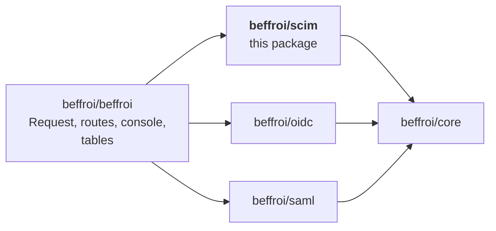

# scim: specification

The SCIM 2.0 module of the identity provider: the service provider of RFC 7643 and RFC 7644 for the directories a deployment declares, which push the persons and the groups of a tenant to it. It holds what the protocol asks of a service provider, the HTTP request aside, which is the application's: the token of a directory, the mapping of the `User` and `Group` schemas and of the `EnterpriseUser` extension onto the identity model of the core and onto the record a directory keeps of a person, the filter, the pagination, the versioning and the errors of the protocol, and what the provider announces of itself.

| | |
|---|---|
| Repository | `src/scim` of the monorepo `beffroi-auth/beffroi`, mirrored read only into `beffroi-auth/scim` (section 10) |
| Package | `beffroi/scim` |
| Namespace | `Beffroi\Scim`, next to `Beffroi\Oidc` of `beffroi/oidc` and `Beffroi\Saml` of `beffroi/saml` |
| Runtime | PHP 8.4 or later; `beffroi/core`, its use cases included; the `intl` extension of PHP, for the Unicode normalization a comparison goes through (section 6.7). Nothing else: the JSON reader is PHP's, and no brick of `docs/09-briques.md` is the module's own. |
| Consumers | The application `beffroi/beffroi` (`apps/beffroi`), which holds the HTTP request, the routes, the console, the tables and the migrations (decision 0007) |
| Design | Spike 10 (epic beffroi-auth/beffroi#84); decisions 0002 (the provider owns its identity model, a directory being one more source of it), 0063 (a directory sees and writes only what it created), 0064 (a deletion is soft, then purged), 0065 (a username compared by PRECIS), 0066 (the author of an act), 0067 (the provider follows the specifications and names what a peer asks beyond them), 0011 (personal data sealed, the filter its named exception), 0014 (the load budget of a directory), 0022 (a read that returns a person is an act), 0006 (no option to do it wrong) |

This document states what the package does, what it refuses and what it guarantees; the code conforms to it, or the document changes first, in its own commit, with its reason. Its invariants are numbered `P-n`, and its sections bear the numbers of the specifications of the SAML packages. Every rule is written before the code that applies it: the stories of section 12 build them, each test citing the rule it verifies (section 9).

## 1. Why this package exists

The core holds a person, the groups of a tenant and the source of each (decision 0002). Federation creates a person at their first sign-in through an upstream provider; SCIM creates them before it, keeps them in step with the directory of the organisation, and deactivates them the day they leave. A directory speaks HTTP and JSON, and its resources are not the identity model: a `User` carries several typed addresses, a manager, a cost centre and a password, where the core holds one address, one phone number, one postal address and the claims of OIDC Core §5.1.

This package is the protocol and the translation between the two, so that a directory is one more source of the provenance model (decision 0063) and not a second model: what the identity model holds goes to the core, what it cannot hold is kept as the directory wrote it, sealed, in a record of that directory (section 6.3), and every claim takes one value of it by a rule written here (section 6.6).

## 2. Position



The package is a module of the identity provider, at the level of `beffroi/oidc` and `beffroi/saml`, and takes their four layers (`docs/11-architecture/README.md` section 2): `Domain`, the objects, the values and the exceptions (`Exception/` belongs to it, as in the core and the other modules); `Port`, the interfaces to the outside; `Application`, the use cases; `Bridge`, the implementations of the ports. It depends on the core, its use cases included, and never on `beffroi/oidc` nor on `beffroi/saml`, nor they on it: protocols never depend on each other. The core depends on none of the three.

It knows no HTTP object (decision 0007): no `Request`, no PSR-7 message, no superglobal, no route. The application reads the request and hands the package what section 5 names, the token presented, the method, the identifier of the path, the parameters of the query, the conditional headers and the bytes of the body; it writes the answer the package gives back, a status, its headers and a JSON document. The tables are the application's too: the resource table of the module (section 6.2), the record of a directory, which the core seals (section 6.3), and the digests of the tokens (P-1) are ports of the package, which the application implements on Doctrine.

Deptrac holds the layers and the graph, `.ci-tools/deptrac.yaml`: the `Scim*` layers see the layers of the core, the PSR interfaces, `psr/clock` and the `Uid` component of Symfony, as the `Oidc*` and `Saml*` layers do; nothing else of Symfony, nothing of `Psr\Http`, nothing of Doctrine, nothing of another module. No layer of the core and no layer of another module sees a `Scim*` layer.

## 3. Threat model

Each row is an attack class this package answers, the rule that answers it, and where the rule lives; the invariants are numbered in section 4.

| Threat | Vector | Rule | Where |
|---|---|---|---|
| A stolen or guessed token writes every person of a directory | The value of a token read in a table, a log, a backup; a value guessed | 256 bits drawn by `random_bytes()`, shown once, its SHA-256 digest kept and compared by `hash_equals()`; an expiry it always has; revocation | P-1, RFC 7644 §7.4 |
| A token outlives its directory | A revoked or expired token, or one of a directory the environment no longer declares | Verified at every request against its expiry, its revocation and the declaration of its directory | P-1 |
| A directory takes over a person of another source | `userName eq` on the username of the emergency account of the administrator, then a `PUT`; the address of a local person pushed on a new one | A directory sees and writes only what it created; a username, an address or a group name another source holds answers `409 uniqueness` and nothing more | P-2, decision 0063 |
| A directory reads a person it did not create | An `id` of another directory or of a local person guessed or replayed | The `id` is drawn by the module per resource; any other answers `404`, the same answer as an `id` nobody holds | P-2, P-3 |
| A directory makes a relying party trust an address it does not hold | An address of another organisation pushed with `email_verified` expected | An address is verified only inside the domains the deployment declares for that directory | P-10, decision 0063 |
| A directory sends the notices of decision 0049 to a number it chose | A phone number pushed for a person | A pushed number is never verified until the person confirms it | P-10, decision 0063 |
| A password guessed through the filter | `password eq "..."` repeated outside the guessing limit of decision 0014 | `password` is never a filter attribute | P-8, decision 0067 |
| A password leaks | Returned in an answer, kept in the record, written to a log or echoed in an error | Hashed by the core, `returned: never`, never in the record, in a log or in the `detail` of an error | P-8, P-19, RFC 7643 §4.1.1, §9.2 |
| A boolean read wrong | `"active": "False"`, which a cast in PHP reads as true | A boolean is the JSON literal `true` or `false`, anything else refused | P-6, decision 0006 |
| A group emptied by a request read loosely | A `remove` on `members` that carries a `value`, read as a `remove` of the whole attribute | A `remove` that carries a `value` is refused | P-7 |
| The provider exhausted by a filter | A filter of a megabyte, nested a thousand times, of ten thousand terms; an operator no index serves on a directory of a million persons | The filter is counted before it is read; the candidates a filter opens in memory are counted before they are opened, `tooMany` past the bound | P-5, P-12, section 7 |
| The provider exhausted by a body | A body of a gigabyte, nested to the stack, with a hundred thousand members | The body, its depth and each of its lists counted before they are read | P-5, section 7 |
| Personal data read in clear in the database | A filter answered by a `LIKE` or an `ORDER BY` on a sealed column | Nothing of a filter is written in clear, searched or sorted in the database but the columns kept in clear; the other operators are evaluated in memory | P-12, decision 0011 |
| Personal data in a log | A filter in the query string, a body logged on an error | The access log keeps the names of the parameters and never their values; nothing of a body is logged | P-20, RFC 7644 §7.5.2 |
| A lost update | Two writes on one resource, the second built on what the first replaced | A weak `ETag` of the version of the core, `If-Match` honoured, `412` when stale | P-14, RFC 7644 §3.14 |
| A duplicate person | Two creations of one username racing | The unique constraint of the core answers `409 uniqueness`, never a second person and never `500` | P-14 |
| The administration taken by a directory | A group created before the tenant under a name `BEFFROI_TENANT_ADMINISTRATORS` lists | A group a directory holds administers the tenant only when the deployment names it with its directory | P-18, decision 0038 |
| A deleted resource comes back | A deleted `id` replayed, or a person restored by an administrator still written by the directory | `404` for every operation on a deleted resource, for good | P-15, RFC 7644 §3.6, decision 0064 |
| A deactivated person keeps signing in | `active: false` written while sessions and tokens live | The person disabled through the core, the sessions ended, the refresh tokens and the opaque access tokens revoked | P-16 |
| An attribute read twice | `userName` and `USERNAME` in one object, which name one attribute (RFC 7643 §2.1) | Two names of one object that differ by their case only are refused | P-21 |
| The record handed to a relying party | A claim, the UserInfo endpoint, an ID token built from what a directory wrote beyond the model | The record is read by SCIM, the archive and the administration only, never by a client | P-9 |

## 4. Invariants

Each invariant is code, never a constructor option or a flag, has at least one test in section 9, and names the attack class it closes.

- **P-1. A directory authenticates by a token of its own.** The token is presented as `Authorization: Bearer` (RFC 6750 §2.1), never in a form body (§2.2) nor in the query (§2.3); any other request, anonymous (RFC 7644 §2.2), Basic or carrying a token that is not valid, answers `401` with `WWW-Authenticate: Bearer` (RFC 6750 §3, RFC 7644 §2), on every route of the module, the three of discovery included (section 6.13). The value is 32 bytes of `random_bytes()`, written in base64url without padding (RFC 4648 §5): RFC 7644 §7.4 asks a bearer token for the entropy that resists guessing. It is shown once, at issuance; the provider keeps its SHA-256 digest only, looks the token up by that digest and compares it with `hash_equals()`. A token names one directory of one tenant, and a request is answered within that tenant alone, whatever its host or its path names (RFC 7644 §6.1 lets the provider infer the tenant from the client it authenticated). It expires (RFC 7644 §7.4: a bearer token MUST have a limited lifetime): a year by default, a lifetime the issuer sets and never omits (decision 0063). A revoked token, an expired one, and one whose directory the environment no longer declares answer `401`. The value is in no table, no log, no answer but the one that issues it, and no event. A stolen or guessed token.
- **P-2. A directory sees and writes only what it created** (decision 0063). A person or a group of another source, local, federated, mapped or of another directory, does not exist for it: its `id` answers `404`, the same answer as an `id` no resource holds, and no query returns it. A username, an address or a group name such a person or group holds answers `409` with `scimType` `uniqueness` (RFC 7644 §3.3, §3.12), and the answer says nothing else of who holds it: that a name is taken is all a directory learns, which no uniqueness can hide (RFC 7643 §4.1.1: a `userName` is unique across the whole service provider). A takeover, and the reading of what a directory did not push.
- **P-3. The `id` is the module's.** It is drawn at random by the module for each resource, 122 random bits written as a UUID of version 4, stable across every write, never given to another resource, and never the identifier of the core, the `sub` of the person nor their `externalId` (RFC 7643 §3.1: issued by the service provider, unique across all of its resources, stable, non-reassignable). An `id` a client sends in a body is ignored (RFC 7643 §3.1, RFC 7644 §3.3). An `id` guessed from another one.
- **P-4. The `sub` is drawn opaque** when a directory creates a person, never taken from `externalId`, `userName` or anything the directory sends (decision 0063). A `sub` chosen by a directory, the same at two tenants.
- **P-5. A request is counted before it is read.** The body by its bytes, before it is decoded; its nesting before it is built; each list of a request, the members of a group, the operations of a `PATCH` and the names of `attributes` and `excludedAttributes` by their number before one of them is read; the filter by its length, its nesting and its terms before it is parsed (section 7). An exhaustion of the process.
- **P-6. A value has the JSON type of its attribute.** A boolean is the literal `true` or `false` (RFC 7643 §2.3.2), an integer a number with no fraction nor exponent (§2.3.4), a string a string, a complex value an object and a multi-valued one an array (§2.3.8, §2.4); anything else answers `400 invalidValue`, and nothing is cast (decision 0006). `"active": "False"` is refused, as decision 0067 names it. A value read as what it is not.
- **P-7. A `PATCH` says what it does.** Its `op` is `add`, `remove` or `replace`, written as RFC 7644 §3.5.2 writes them; `Replace` and any other value answer `400 invalidSyntax` (decision 0067). A `remove` takes a `path` and no `value` (§3.5.2.2): one that carries a `value` answers `400 invalidSyntax`, since read without it it would remove every value of its path. A destructive misreading.
- **P-8. A password is set, never read.** A `password` a directory pushes goes to the core (`UserProvisioner::setPassword()`), with its floor, its lookup in the breached passwords and the refusal of a federated domain (decision 0029), and is hashed there (RFC 7643 §9.2: never stored in cleartext). It is `returned: never` (RFC 7643 §4.1.1, §7), whatever `attributes` names; it is never kept in the record (P-9), written to a log or an event, nor echoed in an error; and it is never a filter attribute (RFC 7643 §7 leaves the provider free not to allow it), a filter naming it answering `400 invalidFilter` (decision 0067). A password leaked, or guessed outside the limit of decision 0014.
- **P-9. What the identity model cannot hold is kept as written, sealed, and read by no client.** Every attribute of `User` and of `EnterpriseUser` a directory writes, but `password` and those section 6.3 keeps out of it, is kept in the record of that directory for the person, as it wrote it, sealed in the `user` family (decision 0011). SCIM reads it back as it was written, the archive of the person carries it as a chapter of its own, and the console and the administration API show it; no claim, no ID token, no UserInfo answer and no SAML assertion carries any of it but the values the claims take by section 6.6. The record handed to a relying party.
- **P-10. A claim takes one value, by a rule, and a verification is earned.** Each claim of the identity model takes the value section 6.6 names: the `primary` value of its attribute, else the first value of the type fixed there for it, else none. The `email` claim is verified only when the domain of the address is one the deployment declares for the directory, and is otherwise kept unverified for the person to confirm (`EmailConfirmation`); the `phone_number` claim is never verified until the person confirms it (decision 0063). A verification a directory grants itself.
- **P-11. A person returned to a directory is an act; a group returns no person.** Each person a `GET` returns, by `id` or in a page, is an act `scim.answered` of that person, naming the directory as author (decisions 0022, 0066), written once the answer is made. A write is the act of the write, and its answer is not a second one; a `304` and a page of `count=0` return nobody. A group names its members by their `id`, `$ref` and `type`, never their `display` (section 6.5): reading a group returns no person and writes no act. A read that leaves no trace.
- **P-12. The filter language is served whole, within bounds, and never against the sealed columns.** Every form of RFC 7644 §3.4.2.2 is served (section 6.8), equalities through an index; a comparison no index serves is evaluated in memory on the candidates of the directory, which are counted before one is opened, and past the bound of section 7 the query answers `400 tooMany` (RFC 7644 §3.4.2.1, §3.12). Nothing of a filter is written in clear, searched or sorted in the database but the columns the provider keeps in clear (decision 0011). An exhaustion of the process; personal data searched in clear.
- **P-13. A write answers what it wrote.** A creation answers `201` with the resource, its `Location` and its `ETag` (RFC 7644 §3.3), so its write is synchronous, the exception architecture §5.6 names; it goes through the one use case its operation calls, and what follows it, the journal, the notices, the logout tokens, leaves through the event bus of the core as everywhere. A write whose answer lies.
- **P-14. A write is conditional when the directory asks, and a race is a conflict.** Every resource carries a weak `ETag`, `W/"n"`, `n` being the version the core counts for the person or the group, and the same value in `meta.version` (RFC 7643 §3.1, RFC 7644 §3.14). An `If-Match` that names no current version answers `412` before anything is written. Two creations of one username or of one group name that race end with one resource and one `409 uniqueness`, the unique constraint of the core deciding, never `500` nor two resources. A lost update; a duplicate.
- **P-15. A deletion is soft, and a deleted resource is gone for the protocol.** `DELETE` answers `204` (RFC 7644 §3.6); the person is deleted softly by the core (decision 0064), and from then on every operation on that `id` answers `404`, no query returns it, and its username and address no longer count for a conflict. A person an administrator restores is local: the deleted `id` answers `404` for good. A deleted resource replayed.
- **P-16. A deactivation ends what the person holds.** `active: false` disables the person through `PersonDisabling`, which ends every session of the core with what the end of a session triggers, the logout tokens and the revocation of the refresh tokens and of the opaque access tokens; `active: true` enables them through `PersonEnabling`. Both name the directory as author. After a deactivation, an authorization request and a refresh for the person are refused, and the introspection of their tokens answers `active: false` (RFC 7662 §2.2). A person who left and still signs in.
- **P-17. A member is a person of the same directory.** The `value` of a member names a `User` the same directory created; any other `id`, a group among them, answers `400 invalidValue`: a group that is a member of a group is not served. A membership written into another source; a cycle of groups.
- **P-18. A group of a directory administers nothing by its name.** A name of `BEFFROI_TENANT_ADMINISTRATORS` designates a local group; a group a directory holds administers the tenant only when the deployment names it with its directory (decision 0038). The administration taken by creating a group.
- **P-19. An error says the rule, never the value.** Every error carries the body of RFC 7644 §3.12, `schemas`, `status` as a JSON string, `scimType` where Table 9 has one, and a `detail` that names the attribute, the parameter or the rule refused and never a value the request carried. A value echoed into a log or a proxy, a password among them.
- **P-20. Nothing of a request is logged but its path and the names of its parameters.** No body, no value of a parameter, no token. The access log of the image already keeps the names of the parameters and never their values (`apps/beffroi/frankenphp/Caddyfile`); the module adds no log of its own that would. A filter carries personal data in the query string (RFC 7644 §7.5.2). Personal data in a log.
- **P-21. An attribute is named once in an object.** Attribute names are read without case (RFC 7643 §2.1, RFC 7644 §3.10); two names of one JSON object that differ by their case only answer `400 invalidSyntax`. Two names that are identical are resolved by the JSON reader, the last one read, and seen by nothing else. An attribute read in two ways.
- **P-22. What the provider announces is what is wired.** `/ServiceProviderConfig`, `/ResourceTypes` and `/Schemas` are derived from the classes that serve each capability and map each attribute, never from a list kept beside them (section 6.13). An announcement that lies.
- **P-23. The package stands on the core alone.** No class of `Beffroi\Scim` uses a class of `Beffroi\Oidc` or of `Beffroi\Saml`, and no class of the core uses a class of `Beffroi\Scim`; Deptrac refuses either (section 2). A protocol that reaches into another.

## 5. Public API

### 5.1 The endpoints served

The base path of a tenant ends in the version segment `v2`, right before the resource endpoint (RFC 7644 §3.13), on the protocol plane of the application. Every answer is `application/scim+json` (RFC 7644 §8.1), the format §3.8 defaults to, carries `Cache-Control: no-store`, and is written by the package.

| Endpoint | Method | Section | Answer |
|---|---|---|---|
| `/Users` | `GET` | RFC 7644 §3.4.2 | `200`, a `ListResponse` of the persons of the directory |
| `/Users` | `POST` | RFC 7644 §3.3 | `201`, the person created |
| `/Users/{id}` | `GET` | RFC 7644 §3.4.1 | `200`, the person, or `304` (section 6.11) |
| `/Users/{id}` | `PUT` | RFC 7644 §3.5.1 | `200`, the person replaced |
| `/Users/{id}` | `PATCH` | RFC 7644 §3.5.2 | `200`, the person patched |
| `/Users/{id}` | `DELETE` | RFC 7644 §3.6 | `204` |
| `/Groups` | `GET` | RFC 7644 §3.4.2 | `200`, a `ListResponse` of the groups of the directory |
| `/Groups` | `POST` | RFC 7644 §3.3 | `201`, the group created |
| `/Groups/{id}` | `GET` | RFC 7644 §3.4.1 | `200`, the group, or `304` |
| `/Groups/{id}` | `PUT` | RFC 7644 §3.5.1 | `200`, the group replaced |
| `/Groups/{id}` | `PATCH` | RFC 7644 §3.5.2 | `204`, or `200` with the group when the request names `attributes` |
| `/Groups/{id}` | `DELETE` | RFC 7644 §3.6 | `204` |
| `/ServiceProviderConfig` | `GET` | RFC 7644 §4, RFC 7643 §5 | `200`, the configuration |
| `/ResourceTypes`, `/ResourceTypes/{name}` | `GET` | RFC 7644 §4, RFC 7643 §6 | `200`, `User` and `Group` |
| `/Schemas`, `/Schemas/{urn}` | `GET` | RFC 7644 §4, RFC 7643 §7 | `200`, the three schemas |
| `/Bulk`, `/.search`, `/Users/.search`, `/Groups/.search`, `/Me` | any | RFC 7644 §3.7, §3.4.3, §3.11 | `501`, not served (section 8) |

### 5.2 What the application hands it

One use case per operation, which the application calls with the directory the token named (P-1) and what the request carries: the identifier of the path, the parameters of the query as pairs in their order, the `If-Match`, `If-None-Match` and `Prefer` headers, and the body as bytes. It gives back the status, the headers of RFC 7644 (`Location`, `Content-Location`, `ETag`) and the JSON document. The names of the classes are the stories' (section 12).

## 6. Processing rules

### 6.1 A request, in order

1. **The token** (P-1), before anything else is read: no body is decoded and no budget spent for a request that names no directory.
2. **The load budget of the directory** (decision 0014), keyed on the directory the token named once verified, never on a value the request chose; past it, `429` (RFC 6585 §4).
3. **The identifier of the path**: one the directory's resources do not hold answers `404` (P-2), before the body is read.
4. **The body**: its `Content-Type` is `application/scim+json` or `application/json` (RFC 7644 §3.8), its bytes are counted (section 7, `413` past the bound, RFC 9110 §15.5.14), then it is decoded as JSON (RFC 8259) in UTF-8, its nesting bounded by the decoder; another type, bytes that are not UTF-8 JSON and a top level that is not an object answer `400 invalidSyntax`. Each list is counted before it is read (P-5).
5. **The names**: attribute names are read without case (RFC 7643 §2.1, RFC 7644 §3.10), a schema URN prefix allowed (§3.10), and two names of one object that differ by their case only are refused (P-21).
6. **The schemas** of a resource in a body name the base schema of its endpoint, may name the `EnterpriseUser` extension on `/Users`, name nothing else and nothing twice (RFC 7643 §3); a missing base schema, an unknown URN and a duplicate answer `400 invalidValue`. An extension container the `schemas` of the body does not name, and an attribute none of its schemas defines, answer `400 invalidValue`: a value the provider would drop could not be read back as written (decision 0063).
7. **The operation** (section 6.10), then the answer and, for a read, its acts (P-11).

### 6.2 The common attributes

RFC 7643 §3.1 defines them for every resource. The **resource table** of the module holds one row per resource a directory pushed (beffroi-auth/beffroi#1424): the directory, the kind, the identifier of the core object, the `id`, the `externalId` sealed under a blind index, and the soft deletion of the resource.

| Attribute | RFC 7643, characteristics | Rule |
|---|---|---|
| `id` | §3.1; string, `readOnly`, `returned: always`, case exact | The module's (P-3), in the resource table; ignored in a body; an `id` of a path that is not one of the directory's resources answers `404` (P-2) |
| `externalId` | §3.1; string, `readWrite`, case exact, issued by the client and scoped to its domain | In the resource table, sealed under a blind index; `eq` goes through that index (section 6.8); the provider enforces no uniqueness (§3.1), and an `externalId` is read within the resources of its directory only |
| `meta` | §3.1; complex, `readOnly` | Ignored in a body (§3.1: SHALL be ignored when provided by clients); written by the provider |
| `meta.resourceType` | §3.1; string, `readOnly`, case exact | `User` or `Group`, the endpoint the resource was created at (RFC 7644 §3.3.1) |
| `meta.created` | §3.1; dateTime, `readOnly` | The creation of the person or the group in the core |
| `meta.lastModified` | §3.1; dateTime, `readOnly` | The last change of the person or the group in the core (beffroi-auth/beffroi#1422), `meta.created` until a first change (§3.1) |
| `meta.location` | §3.1; reference, `readOnly` | The URL of the resource under the base path of the tenant, the same value as the `Content-Location` header of the answer (§3.1) |
| `meta.version` | §3.1; string, `readOnly`, case exact | The weak `ETag` of the resource, `W/"n"` (P-14, section 6.11) |
| `schemas` | §3; string, multi-valued, required | Read by step 6 of section 6.1; answered with the base schema, and with the `EnterpriseUser` URN when the record holds an attribute of the extension |

### 6.3 The `User` schema

RFC 7643 §4.1, `urn:ietf:params:scim:schemas:core:2.0:User`, its characteristics those of §8.7.1 unless the row says otherwise. **The identity model** is the person of the core: `User::$username`, the `Profile` of OIDC Core §5.1, one `EmailAddress`, one phone number, one `Address` of OIDC Core §5.1.1, and the state of the person. **The record** is what the directory wrote of the person, kept as written (P-9, beffroi-auth/beffroi#1419): a read answers each attribute from it, except `id`, `externalId`, `meta`, `userName`, `active` and `groups`, which are the provider's state (RFC 7644 §3.1: an answer reflects the resource as the service provider holds it), and `password`, which nothing answers. Each value is held to the bound of its kind in section 7 and refused past it with `400 invalidValue`.

| Attribute | RFC 7643, characteristics | Identity model | Record and rule |
|---|---|---|---|
| `userName` | §4.1.1; string, required, case insensitive, `uniqueness: server` | `User::$username`, as written; prepared, enforced and compared by the UsernameCaseMapped profile of PRECIS (RFC 8265 §3.3, RFC 7644 §5, decision 0065) | Not in the record. Missing: `400 invalidValue`. Refused by PRECIS: `400 invalidValue`. Held by another person: `409 uniqueness` (P-2). Never copied to `preferred_username` |
| `name` | §4.1.1; complex | The parts below | Kept as written |
| `name.formatted` | §4.1.1; string | Claim `name` (OIDC Core §5.1), by section 6.6 | Kept as written |
| `name.familyName` | §4.1.1; string | Claim `family_name` | Kept as written |
| `name.givenName` | §4.1.1; string | Claim `given_name` | Kept as written |
| `name.middleName` | §4.1.1; string | Claim `middle_name` | Kept as written |
| `name.honorificPrefix` | §4.1.1; string | None: OIDC Core §5.1 has no such claim | Kept as written |
| `name.honorificSuffix` | §4.1.1; string | None | Kept as written |
| `displayName` | §4.1.1; string | Claim `name` when `name.formatted` is absent, by section 6.6 | Kept as written |
| `nickName` | §4.1.1; string | Claim `nickname` | Kept as written |
| `profileUrl` | §4.1.1; reference to an external resource | Claim `profile`, an absolute `https` or `http` URL (`Profile`), any other refused with `400 invalidValue` | Kept as written |
| `title` | §4.1.1; string | None | Kept as written |
| `userType` | §4.1.1; string | None | Kept as written |
| `preferredLanguage` | §4.1.1; string, the value of an `Accept-Language` header | None: the locale of an interaction comes from `ui_locales`, then `Accept-Language` | Kept as written |
| `locale` | §4.1.1; string, a language tag | Claim `locale`, plain text as the core holds it | Kept as written |
| `timezone` | §4.1.1; string, a name of the IANA time zone database | Claim `zoneinfo`, plain text as the core holds it | Kept as written |
| `active` | §4.1.1; boolean | The state of the person: `false` through `PersonDisabling`, `true` through `PersonEnabling` (P-16); `true` when a creation omits it | Not in the record; answered from the state of the person |
| `password` | §4.1.1; string, `writeOnly`, `returned: never` | The password credential, through `UserProvisioner::setPassword()` (P-8) | Never in the record, never answered, never a filter attribute (P-8) |
| `emails` | §4.1.2; complex, multi-valued | Claim `email` by section 6.6, verified by P-10 | Every value kept as written |
| `emails.value` | §2.4, §4.1.2; string, an address of RFC 5321 | The value section 6.6 selects is an `EmailAddress`, refused with `400 invalidValue` when it is not one | Kept as written |
| `emails.display` | §2.4; string | None | Kept as written |
| `emails.type` | §2.4, §4.1.2; string, canonical `work`, `home`, `other` | The type of section 6.6 is `work` | Kept as written; another value accepted (§4.1.2) |
| `emails.primary` | §2.4; boolean, `true` at most once | Selects the value of section 6.6 | Kept as written; a second `true` refused with `400 invalidValue` (§2.4) |
| `phoneNumbers` | §4.1.2; complex, multi-valued | Claim `phone_number` by section 6.6, never verified (P-10) | Every value kept as written |
| `phoneNumbers.value` | §2.4, §4.1.2; string, RFC 3966 recommended | The value section 6.6 selects, plain text of the core's phone number | Kept as written |
| `phoneNumbers.display` | §2.4; string | None | Kept as written |
| `phoneNumbers.type` | §2.4, §4.1.2; string, canonical `work`, `home`, `mobile`, `fax`, `pager`, `other` | The type of section 6.6 is `mobile` | Kept as written; another value accepted (§4.1.2) |
| `phoneNumbers.primary` | §2.4; boolean, `true` at most once | Selects the value of section 6.6 | Kept as written; a second `true` refused |
| `ims` | §4.1.2; complex, multi-valued | None | Every value kept as written |
| `ims.value` | §2.4; string | None | Kept as written |
| `ims.display` | §2.4; string | None | Kept as written |
| `ims.type` | §2.4, §4.1.2; string, canonical `aim`, `gtalk`, `icq`, `xmpp`, `msn`, `skype`, `qq`, `yahoo`, `other` | None | Kept as written; another value accepted (§4.1.2) |
| `ims.primary` | §2.4; boolean, `true` at most once | None | Kept as written; a second `true` refused |
| `photos` | §4.1.2; complex, multi-valued | Claim `picture` by section 6.6 | Every value kept as written |
| `photos.value` | §2.4, §4.1.2; reference to an external resource | The value section 6.6 selects is an absolute `https` or `http` URL (`Profile`), any other refused with `400 invalidValue` | Kept as written |
| `photos.display` | §2.4; string | None | Kept as written |
| `photos.type` | §2.4, §4.1.2; string, canonical `photo`, `thumbnail` | The type of section 6.6 is `photo` | Kept as written |
| `photos.primary` | §2.4; boolean, `true` at most once | Selects the value of section 6.6 | Kept as written; a second `true` refused |
| `addresses` | §4.1.2; complex, multi-valued | Claim `address` (OIDC Core §5.1.1) by section 6.6 | Every value kept as written |
| `addresses.formatted` | §4.1.2; string, may hold lines | `Address::$formatted`, lines separated by line feeds | Kept as written |
| `addresses.streetAddress` | §4.1.2; string, may hold lines | `Address::$streetAddress` (`street_address`) | Kept as written |
| `addresses.locality` | §4.1.2; string | `Address::$locality` | Kept as written |
| `addresses.region` | §4.1.2; string | `Address::$region` | Kept as written |
| `addresses.postalCode` | §4.1.2; string | `Address::$postalCode` (`postal_code`) | Kept as written |
| `addresses.country` | §4.1.2; string, an ISO 3166-1 alpha-2 code | `Address::$country` | Kept as written; a value that is not two ASCII letters refused with `400 invalidValue` (§4.1.2: MUST be in alpha-2 code format) |
| `addresses.type` | §2.4, §4.1.2; string, canonical `work`, `home`, `other` | The type of section 6.6 is `work` | Kept as written |
| `addresses.primary` | §2.4; boolean, `true` at most once | Selects the value of section 6.6 | Kept as written; a second `true` refused |
| `groups` | §4.1.2; complex, multi-valued, `readOnly` | The groups of the same directory the person is a direct member of (section 6.5) | Not in the record; ignored in a `POST` or a `PUT` (RFC 7644 §3.3, §3.5.1), a `PATCH` on it refused with `400 mutability` (§3.5.2) |
| `groups.value` | §4.1.2; string, `readOnly` | The `id` of the group (P-3) | Answered |
| `groups.$ref` | §4.1.2; reference to a `Group`, `readOnly` | The `meta.location` of the group | Answered |
| `groups.display` | §2.4; string, `readOnly` | The name of the group, which names no person | Answered |
| `groups.type` | §4.1.2; string, canonical `direct`, `indirect`, `readOnly` | `direct`, the only membership there is without nested groups (P-17) | Answered |
| `entitlements` | §4.1.2; complex, multi-valued | None: an entitlement grants nothing, no role of the provider nor of Symfony | Every value kept as written |
| `entitlements.value` | §2.4; string | None | Kept as written |
| `entitlements.display` | §2.4; string | None | Kept as written |
| `entitlements.type` | §2.4; string | None | Kept as written |
| `entitlements.primary` | §2.4; boolean, `true` at most once | None | Kept as written; a second `true` refused |
| `roles` | §4.1.2; complex, multi-valued | None: a role grants nothing, no role of the provider nor of Symfony | Every value kept as written |
| `roles.value` | §2.4; string | None | Kept as written |
| `roles.display` | §2.4; string | None | Kept as written |
| `roles.type` | §2.4; string | None | Kept as written |
| `roles.primary` | §2.4; boolean, `true` at most once | None | Kept as written; a second `true` refused |
| `x509Certificates` | §4.1.2; complex, multi-valued | None: a certificate a directory pushes authenticates nothing | Every value kept as written |
| `x509Certificates.value` | §2.3.6, §4.1.2; binary, one DER certificate in base64 | None | Kept as written; a value that is not base64 (RFC 4648 §4) refused with `400 invalidValue` (§2.3.6: MUST be base64 encoded) |
| `x509Certificates.display` | §2.4; string | None | Kept as written |
| `x509Certificates.type` | §2.4; string | None | Kept as written |
| `x509Certificates.primary` | §2.4; boolean, `true` at most once | None | Kept as written; a second `true` refused |

The claims that section 6.6 maps are held by the directory as a whole, `userName` with them, whether a request names them or not, since a `PUT` clears what it omits (section 6.10): a manual edit of one of them is refused with the name of the directory (`UserSource::assertLeaves()`, beffroi-auth/beffroi#1417). The claims no attribute maps, `preferred_username`, `website`, `gender` and `birthdate`, are not held, and the person says them of themselves where the tenant opens them.

### 6.4 The `EnterpriseUser` extension

RFC 7643 §4.3, `urn:ietf:params:scim:schemas:extension:enterprise:2.0:User`, the attributes in a container of that name (RFC 7643 §3.3). None of them is a claim of OIDC Core §5.1.

| Attribute | RFC 7643, characteristics | Identity model | Record and rule |
|---|---|---|---|
| `employeeNumber` | §4.3; string | None | Kept as written |
| `costCenter` | §4.3; string | None | Kept as written |
| `organization` | §4.3; string | None | Kept as written |
| `division` | §4.3; string | None | Kept as written |
| `department` | §4.3; string | None | Kept as written |
| `manager` | §4.3; complex | None | Kept as the reference the directory sent |
| `manager.value` | §4.3; string, the `id` of another `User` | None | Kept as written; not checked against the resources of the directory (RFC 7643 §2.3.7 leaves referential integrity to the provider, which does not enforce it here) |
| `manager.$ref` | §4.3; reference to a `User` | None | Kept as written |
| `manager.displayName` | §4.3; string, `readOnly`, optional | None | Ignored in a body (RFC 7644 §3.3) and never answered: answering it would read another person |

### 6.5 The `Group` schema

RFC 7643 §4.2, `urn:ietf:params:scim:schemas:core:2.0:Group`. A group of a directory is a `Group` of the core whose source is `scim` (`GroupSource::Scim`), managed (`GroupSource::isManaged()`): neither it nor its members are edited locally (beffroi-auth/beffroi#1421). A group has no record: each of its attributes is the core's or the resource table's.

| Attribute | RFC 7643, characteristics | Identity model | Rule |
|---|---|---|---|
| `displayName` | §4.2; string, required | `Group::$name`, brought to NFC, then held to the rules of the core for a name | Missing, or refused by the core: `400 invalidValue`. Held by a group of another source: `409 uniqueness` (P-2). A name of `BEFFROI_TENANT_ADMINISTRATORS` grants nothing by itself (P-18) |
| `members` | §4.2; complex, multi-valued | The memberships of the group, of source `scim` | Counted before they are read (P-5); a read that would return more members than section 7 allows answers `400 tooMany` (RFC 7644 §3.12), and the same read with `excludedAttributes=members` answers the group without them |
| `members.value` | §4.2; string, `immutable`, the `id` of a resource | The person the `id` names | A `User` the same directory created; any other `id`, a `Group` included, `400 invalidValue` (P-17) |
| `members.$ref` | §4.2; reference to a `User` or a `Group`, `immutable` | None | Ignored in a body; answered as the `meta.location` of the member |
| `members.type` | §4.2; string, canonical `User`, `Group`, `immutable` | None | `User`, or absent; `Group` refused with `400 invalidValue` (P-17); answered `User` |
| `members.display` | §2.4; string, `immutable`; not in the `Group` schema of §8.7.1 | None | Ignored in a body, never kept, never answered (P-11) |

### 6.6 The claims a person takes from what a directory wrote

Each claim takes the `primary` value of its attribute (RFC 7643 §2.4), else the first value whose `type` is the one below, else none: the claim is then unset, and every value stays in the record. A singular attribute is taken as it is.

| Claim (OIDC Core §5.1) | Attribute | Type when no value is `primary` | Verification |
|---|---|---|---|
| `name` | `name.formatted`, else `displayName` | | |
| `given_name` | `name.givenName` | | |
| `family_name` | `name.familyName` | | |
| `middle_name` | `name.middleName` | | |
| `nickname` | `nickName` | | |
| `profile` | `profileUrl` | | |
| `picture` | `photos.value` | `photo`, the full image and not its thumbnail | |
| `zoneinfo` | `timezone` | | |
| `locale` | `locale` | | |
| `email` | `emails.value` | `work`, an enterprise directory's address of the person | Verified only inside the domains of the directory (P-10) |
| `phone_number` | `phoneNumbers.value` | `mobile`, the number a message of decision 0049 can reach | Never verified until the person confirms it (P-10) |
| `address` | the sub-attributes of `addresses` | `work` | |
| `sub` | none: drawn by the core (P-4) | | |
| `updated_at` | none: the last change of the person in the core | | |

### 6.7 Values and their comparison

- A string compares as the `caseExact` characteristic of its attribute says (RFC 7643 §7, RFC 7644 §3.4.2.2): a case exact one by its octets, as written; a case insensitive one after the Unicode normalization form C and the full case folding of Unicode on both sides; `userName` by the enforced form of PRECIS (P-2, decision 0065), and the local part of an address in NFC without case, its domain folded (decision 0065).
- A dateTime is an `xsd:dateTime` with a date and a time (RFC 7643 §2.3.5), compared in time; a value of a filter that is not one answers `400 invalidFilter`.
- A boolean and a binary value have no order (RFC 7644 §3.4.2.2, Table 3), and `co`, `sw` and `ew` take strings only (section 6.8).
- `null` and an empty array make an attribute unassigned (RFC 7643 §2.5): in a write they clear it, in a filter `eq null` matches an unassigned attribute and `ne null` an assigned one.

### 6.8 The filter

**The language** is the whole of RFC 7644 §3.4.2.2: the attribute operators of Table 3 (`eq`, `ne`, `co`, `sw`, `ew`, `pr`, `gt`, `ge`, `lt`, `le`), the logical operators of Table 4 (`and`, `or`, `not`), the grouping of Table 5, parentheses and value paths (`emails[type eq "work" and value co "@example.com"]`), under the grammar of Figure 1 and in the order of operations it gives: grouping, then `not` before `and` before `or`, then the attribute operators.

- Attribute names and operators are read without case (§3.4.2.2), the logical operators with them, an ABNF string being case insensitive (RFC 5234 §2.3); the literals `true`, `false` and `null` are those of JSON, in lower case.
- An attribute path may carry the URN of its schema (§3.10). A complex multi-valued attribute named without a sub-attribute stands for its `value` (`emails co "example.com"`, Figure 2). A multi-valued attribute matches when one of its values does (§3.4.2.2).
- A value path holds sub-attributes of its parent, never another value path: a complex attribute has no complex sub-attribute (RFC 7643 §2.3.8).
- `co`, `sw` and `ew` take a string attribute and a string; `gt`, `ge`, `lt` and `le` a string, a number or a dateTime, and a boolean or a binary attribute answers `400 invalidFilter` (Table 3); a value of another JSON type than the attribute answers `400 invalidFilter`.

**What it refuses**, each with `400 invalidFilter` (§3.4.2.2, Table 9): an operator the language does not define (`regex`); a filter the grammar does not read; an attribute the schema of the endpoint does not define, and one the provider does not keep (`members.display`, `manager.displayName`); `password` (P-8).

**How it is answered.** A comparison is answered by the database when it is one of these, and evaluated in memory otherwise:

| Endpoint | Answered by an index | Answered on a column kept in clear |
|---|---|---|
| `/Users` | `id eq`, `externalId eq` (the blind index of the resource table), `userName eq` (the blind index of the core, on the form PRECIS enforces), `groups.value eq` (the memberships); `pr` on `id`, `externalId` and `userName` | Every operator of Table 3 on `meta.created` and `meta.lastModified`; `eq`, `ne` and `pr` on `active` |
| `/Groups` | `id eq`, `externalId eq`, `displayName eq` (on the form section 6.7 compares), `members.value eq` (the memberships); `pr` on `id`, `externalId` and `displayName` | Every operator of Table 3 on `meta.created` and `meta.lastModified` |

An `and` is answered on the candidates of the side the database answers; an `or` and a `not` that hold a comparison evaluated in memory take every resource of the directory for candidates. The candidates are the resources of the requesting directory only, never a deleted one (P-15); they are counted before one is opened, and past the bound of section 7 the query answers `400 tooMany` (§3.4.2.1). The remaining comparisons are evaluated in memory on the candidates, opened by the KMS as every sealed column is; nothing of them is written in clear, searched or sorted in the database (P-12).

### 6.9 Pagination and the attributes of an answer

- **Pagination** is by index (RFC 7644 §3.4.2.4). `startIndex` is 1 by default and a value below 1 is read as 1; `count` is 100 by default and at most, a larger one read as 100, a negative one as 0, and 0 answers `totalResults` alone. A value that is not an integer answers `400 invalidValue`. The answer is a `ListResponse` (§3.4.2) with `totalResults`, `itemsPerPage`, `startIndex` and `Resources`, the last one empty when the page starts past the end; a query that matches nothing answers `200` with `totalResults` at 0 (§3.4.2). The resources come in the stable order of the resource table, their creation order: sorting is not served (section 8).
- **`attributes` and `excludedAttributes`** (RFC 7644 §3.4.2.5, §3.9) are served on every operation that returns a resource, as comma-separated names in the notation of §3.10, read without case, a schema URN naming its whole extension. They are mutually exclusive (§3.9): both answer `400 invalidValue`, and so does a name the schema does not define. `id` is always returned (`returned: always`), `password` never (`returned: never`), whatever either names.
- A parameter the provider does not recognize is ignored (§3.4.2), the `cursor` of RFC 9865 among them.

### 6.10 The operations

- **Creation**, `POST` (RFC 7644 §3.3): the attributes that are `readOnly` are ignored, a required one missing answers `400 invalidValue`, a conflict `409 uniqueness` (P-2, P-14). The answer is `201`, the resource, `Location` and `Content-Location` at its `meta.location`, and its `ETag` (P-13).
- **Reading**, `GET` (RFC 7644 §3.4.1, §3.4.2): `200`, or `304` with no body when `If-None-Match` names the current version (section 6.11). Each person returned is an act (P-11).
- **Replacement**, `PUT` (RFC 7644 §3.5.1): never a creation (§3.2), an unknown `id` answering `404`, and a required attribute missing answering `400 invalidValue` (§3.5.1: a client MUST specify it). A `readWrite` attribute the body omits is cleared, as §3.5.1 lets the provider assume; two are left as they are, `active`, whose absence asserts no state the person could take, and `password`, which is `writeOnly` and which no directory can read back to send again. A `readOnly` attribute is ignored; the members of a group are replaced as a whole. The answer is `200` with the resource.
- **Patch**, `PATCH` (RFC 7644 §3.5.2): the body names `urn:ietf:params:scim:api:messages:2.0:PatchOp` and carries `Operations`, one operation at least, each with exactly one `op` (P-7) and a `path` of Figure 7, optional for `add` and `replace`, required for `remove`, which without one answers `400 noTarget` (§3.5.2.2). The operations apply in order and the request is atomic: one failure restores the resource whole and answers its error (§3.5.2). A `primary` set to `true` sets every other value of its attribute to `false` (§3.5.2). An `add` of a value already there changes nothing, neither the version nor `meta.lastModified` (§3.5.2.1); a `remove` whose value path matches nothing changes nothing; a `replace` whose value path matches nothing answers `400 noTarget` (§3.5.2.3). An attribute named with the URN of the extension adds the extension to the `schemas` of the person (§3.5.2). A path the grammar does not read answers `400 invalidPath`; an operation that changes a `readOnly` attribute, or an `immutable` one that has a value, and the removal of a required one, answer `400 mutability` (§3.5.2, §3.5.2.2). A person patched answers `200` with the resource; a group `204`, or `200` with the group when the request names `attributes` (§3.5.2), since its answer would otherwise carry its members.
- **Deletion**, `DELETE` (RFC 7644 §3.6): `204`, then P-15.
- **`Prefer: respond-async`** (RFC 9967 §2.5.1.1) is answered with the normal answer of the operation, which RFC 9967 allows; the asynchronous completion of a write is not served (section 8).

### 6.11 Versioning

`meta.version` and the `ETag` header carry the same weak entity tag, `W/"n"` (RFC 7643 §3.1, RFC 7644 §3.14), `n` the version of the person or the group in the core, raised once by each change, a change of membership raising the group's (beffroi-auth/beffroi#1422). The tag is weak because the representation it validates varies with `attributes` and `excludedAttributes` (RFC 7643 §3.1: a version that is not a strong validator MUST be marked weak).

`If-Match` on `PUT`, `PATCH` and `DELETE`, and `If-None-Match` on `GET`, compare with the weak comparison of RFC 7232 §2.3.2. For `If-Match` this departs from RFC 7232 §3.1, which asks the strong comparison: RFC 7644 §3.14 names weak tags as the mechanism that keeps a client from overwriting another's changes and writes `If-Match: W/"..."` in its examples, which a strong comparison would never match. `If-Match: *` matches any resource the directory holds. An `If-Match` that matches nothing answers `412` (RFC 7232 §4.2, RFC 7644 §3.12) and writes nothing; an `If-None-Match` that matches answers `304` (RFC 7232 §4.1). A request without either is not conditional (§3.14: a client MAY supply `If-Match`).

### 6.12 Errors

Every error is the document of RFC 7644 §3.12 (P-19): `schemas` `["urn:ietf:params:scim:api:messages:2.0:Error"]`, `status` as a JSON string, `scimType` where the table has one, and a `detail` that names what was refused.

| Status | `scimType` | When |
|---|---|---|
| `400` | `invalidSyntax` | A body that is not a JSON object in UTF-8, or of another `Content-Type`; a `PATCH` without its schema or its `Operations`; an `op` that is not one of the three (P-7); a `remove` with a `value` (P-7); two names of one object that differ by their case only (P-21) |
| `400` | `invalidValue` | A value of the wrong JSON type (P-6); a required attribute missing; `schemas` refused (section 6.1); an attribute no schema defines; a value refused by its bound or by the core, a username PRECIS refuses, a password the core refuses (P-8); a second `primary`; a member of another source, or a group (P-17); a `startIndex` or a `count` that is not an integer; `attributes` with `excludedAttributes`, or a name the schema does not define |
| `400` | `invalidFilter` | Section 6.8 |
| `400` | `tooMany` | The candidates of a filter, or the members a group would answer, past their bound (section 7) |
| `400` | `invalidPath`, `noTarget`, `mutability` | Section 6.10 |
| `401` | | P-1, with `WWW-Authenticate: Bearer` |
| `403` | | A `filter` on `/ResourceTypes` or `/Schemas` (RFC 7644 §4) |
| `404` | | An `id` the directory does not hold (P-2), a deleted resource (P-15) |
| `409` | `uniqueness` | P-2, P-14 |
| `412` | | Section 6.11 |
| `413` | | A body past its bound (section 7) |
| `429` | | The load budget of the directory (decision 0014) |
| `501` | | What section 8 does not serve |

`sensitive` (RFC 7644 §7.5.2) is never answered: a filter in the query string is served, since `/.search` is not and the value of a parameter is in no log (P-20).

### 6.13 Discovery

`/ServiceProviderConfig` (RFC 7643 §5), `/ResourceTypes` (§6) and `/Schemas` (§7) answer `GET` only (RFC 7644 §4). On `/ResourceTypes` and `/Schemas` the parameters of a query are ignored and a `filter` answers `403` (§4). Each capability is announced by the class that serves it, and each attribute of `/Schemas` read from the class that maps it (P-22, beffroi-auth/beffroi#1430):

| Capability | Announced |
|---|---|
| `patch` | `supported: true` (RFC 7644 §3.5.2) |
| `bulk` | `supported: false`, `maxOperations: 0`, `maxPayloadSize: 0` (§3.7, section 8) |
| `filter` | `supported: true`, `maxResults: 100`, the largest `count` (section 6.9) |
| `changePassword` | `supported: true` (P-8) |
| `sort` | `supported: false` (section 8) |
| `etag` | `supported: true` (section 6.11) |
| `authenticationSchemes` | One, `type: oauthbearertoken`, its `specUri` RFC 6750 (P-1) |
| `securityEvents` | Absent: RFC 9967 §4 reads its absence as no support (section 8) |

`/ResourceTypes` names `User`, endpoint `/Users`, schema `urn:ietf:params:scim:schemas:core:2.0:User`, with the extension `urn:ietf:params:scim:schemas:extension:enterprise:2.0:User`, `required: false`; and `Group`, endpoint `/Groups`. `/Schemas` describes the three schemas with the characteristics the provider applies, those of RFC 7643 §8.7.1 with these corrections: `displayName` of `Group` is `required: true` (§4.2), and the sub-attributes the provider does not keep, `members.display` and `manager.displayName`, are not described.

RFC 7643 §5 asks that the authentication schemes be readable without authentication; the three endpoints ask the token as the others do (P-1), so that an anonymous request learns nothing of a tenant, and the `WWW-Authenticate` header of the `401` names the scheme (RFC 7644 §2).

## 7. Limits

| Bound | Value | Why |
|---|---|---|
| The body of a request | 1 048 576 bytes, counted before it is decoded; `413` past it | The provider's choice: a group of 1 000 members written as RFC 7644 §3.5.2.1 writes one takes 148 099 bytes, 14 % of it; the bound is the module's, below the 2 MiB the image allows a body at its edge, so that it holds whatever a deployment sets there |
| The nesting of a body | 8 levels of arrays and objects | The provider's choice: a `PATCH` of an address of a person nests 6, the deepest form these schemas take, and the decoder holds a frame per level |
| The values of a multi-valued attribute of a `User`, the operations of a `PATCH`, the names of `attributes` or `excludedAttributes` | 100 each, counted before one is read | The bound of a list of a request (decision 0061; `docs/11-architecture/choix.md`, « Charge et déploiement ») |
| The members a request carries | 1 000, every operation of a `PATCH` together, counted before one is read | The provider's choice: a group lists the persons of a unit of the organisation, which a list of a request does not, and a `PUT` carries them all (RFC 7644 §3.5.1); a larger group is written by successive `PATCH` |
| The members a group answers | 1 000; past it, `400 tooMany` to a read that returns them | The same figure, so that what a request may write whole is read back whole; a larger group is read with `excludedAttributes=members` and its memberships found by `members.value eq` |
| The length of a filter | 4 096 bytes, decoded | The provider's choice: percent-encoded, three times that still fits the 16 KiB the edge allows the request line and the headers, the token among them |
| The nesting of a filter | 10 levels of parentheses, value paths and `not` | The provider's choice: the filters of RFC 7644 §3.4.2.2, Figure 2, nest one level, and the reader holds a frame per level |
| The terms of a filter | 100 attribute expressions | The bound of a list of a request (decision 0061) |
| The candidates a filter evaluates in memory | 1 000 resources of the directory; past them, `400 tooMany` | The provider's choice: ten pages of the largest `count`, opened and compared within one request; a larger directory reaches its persons by an indexed equality (section 6.8) |
| `count` | 100 at most and by default | The largest page of the administration API (decision 0014), announced as `filter.maxResults` |
| A string | 255 characters; a reference 2 048; `addresses.formatted` and `addresses.streetAddress` 1 024, in lines; a phone number 64 | The bounds of the core's `PlainText`, which every value of the identity model already meets, applied to the record alike |
| A binary value | 8 192 characters of base64 | The provider's choice: a hundred certificates at the bound still fit the body |
| The lifetime of a token | A year by default, set at issuance, never omitted | Decision 0063, RFC 7644 §7.4 |
| The load budget of a directory | The numbers of the deployment | Decision 0014 |

## 8. What is refused, what is not served

**Refused**, each with its rule:

- A boolean that is not the literal `true` or `false`, and every value of another JSON type than its attribute (P-6).
- An `op` other than `add`, `remove` and `replace` as RFC 7644 §3.5.2 writes them, and a `remove` that carries a `value` (P-7).
- `password` as a filter attribute, and `password` in any answer (P-8).
- A member that is a group, or a person of another source (P-17): nested groups are not served.
- A schema other than `User`, `EnterpriseUser` and `Group`, and an attribute none of them defines (section 6.1): custom schemas are not served, for a tenant or for a directory.
- A token in a form body or in the query (RFC 6750 §2.2, §2.3), a Basic credential, and an anonymous request (P-1).

**Not served**, and announced so where RFC 7643 §5 has a place for it:

- `Bulk` (RFC 7644 §3.7): `bulk.supported: false`; `/Bulk` answers `501`.
- Sorting (RFC 7644 §3.4.2.3): `sort.supported: false`; a request that names `sortBy` or `sortOrder` answers `501` rather than a page in another order than the one asked.
- The search by `POST` (RFC 7644 §3.4.3): `/.search` answers `501`.
- `/Me` (RFC 7644 §3.11): `501`, as §3.11 asks of a provider that does not serve it.
- The pagination by cursor of RFC 9865: no `pagination` in `/ServiceProviderConfig`, and `cursor` ignored (section 6.9).
- The security events of RFC 9967 and the asynchronous completion of a write: no `securityEvents` in `/ServiceProviderConfig`, `Prefer: respond-async` answered normally (section 6.10). They are sub-spike 14d (beffroi-auth/beffroi#1413).
- The referential integrity of `manager` (section 6.4), the `display` of a member and the `displayName` of a manager (sections 6.4, 6.5).

## 9. Acceptance

Every test cites the rule it verifies, by its invariant or its section. The table says which story shows each rule; the story writes its rows here as it builds them.

| Rule | Story | What is shown |
|---|---|---|
| P-23, section 2 | beffroi-auth/beffroi#1414 | Deptrac refuses a class of `Beffroi\Scim` that uses a class of `Beffroi\Oidc` or of `Beffroi\Saml`, and a class of the core that uses a class of `Beffroi\Scim` |
| Section 5.1, P-19, P-20, section 6.1 steps 4 and 5 | beffroi-auth/beffroi#1415 | SCIM off, every route answers `404`; on, a body past the bound refused before it is decoded, a body that is not JSON answered `400 invalidSyntax`, every answer `application/scim+json` with `Cache-Control: no-store` |
| P-1 | beffroi-auth/beffroi#1416 | A valid token reaches the routes; a revoked, an expired and an unknown token, and a Basic credential, answered `401`; no issuance without an expiry; the value in no table and no log; past the load budget, `429` |
| P-2, P-4, P-10 | beffroi-auth/beffroi#1417 | A person created by a directory names it as source; a held field edited locally refused; a held address refused; an address inside the domains verified, outside not; a phone number not verified; a `sub` that is not the `externalId` |
| P-11, P-16 (the author) | beffroi-auth/beffroi#1418 | Each kind of author written and read back |
| P-9, sections 6.3, 6.6 | beffroi-auth/beffroi#1419 | Three typed phone numbers written and read back; the `phone_number` claim taking the primary one, else `mobile`; none of the record in clear in a dump; the archive carrying its chapter; no UserInfo answer carrying any of it |
| P-15 | beffroi-auth/beffroi#1420 | After a deletion, `404`, the address free for a new person; a restore local, the deleted `id` still `404` |
| P-17, P-18, section 6.5 | beffroi-auth/beffroi#1421 | A group created, renamed and deleted, a member added and removed, each with its event; a nested member refused; a bare name of `BEFFROI_TENANT_ADMINISTRATORS` granting nothing |
| P-14, section 6.11 | beffroi-auth/beffroi#1422 | Every change raising the version once, a membership raising the group's |
| Section 6.7 (`userName`) | beffroi-auth/beffroi#1423 | Usernames compared equal and not, refused and accepted, by PRECIS |
| P-3, section 6.2 | beffroi-auth/beffroi#1424 | A directory listing its own rows only; `externalId eq` through its index; no `externalId` in clear in a dump; an `id` unchanged by every write |
| P-5, P-8, P-12, section 6.8 | beffroi-auth/beffroi#1425 | One filter per operator and per form of the grammar, evaluated; each refusal with its `scimType`; `password` refused; the bound of the candidates answered `tooMany` |
| P-11, section 6.9 | beffroi-auth/beffroi#1426 | A person read by `id` and in pages; another source's person not found; an empty query `200`; no `password` answered; one act per person returned |
| P-6, P-7, P-8, P-13, P-14, P-21, section 6.10 | beffroi-auth/beffroi#1427 | Creation, replacement and each form of patch; `409` on a held username and address and on a race; `412` on a stale `If-Match`; `"False"` and `Replace` refused; a pushed password hashed and never returned |
| P-15, P-16 | beffroi-auth/beffroi#1428 | A deactivation then the authorization request and the refresh refused and the introspection inactive; a reactivation; a deletion `204` then `404` |
| P-5, P-11, P-17, section 6.5 | beffroi-auth/beffroi#1429 | The group examples of RFC 7644 answered; a member of another source refused; members past their bound refused |
| P-22, section 6.13 | beffroi-auth/beffroi#1430 | A mapping class removed, its attribute leaving `/Schemas`; the three documents read by the discovery checks of scim2-tester |

## 10. Repository

In the shape of `beffroi/oidc` for the code, of `beffroi/saml` for the specification: developed in `src/scim` of the monorepo `beffroi-auth/beffroi` and mirrored read only into `beffroi-auth/scim` by the split, the tests and the toolchain staying in the monorepo.

```
src/scim/              the package, what the mirror carries
  composer.json        beffroi/scim, MIT, php >=8.4, ext-intl; beffroi/core at self.version (the release line of the
                       monorepo); PSR-4 Beffroi\Scim\ => src/; no dev dependency: the tools live in the phpqa image
  README.md            the short version of this document
  spec/scim.md         this document, the law of the package
  src/                 Domain/, Exception/, Port/, Application/, Bridge/ (section 2), from the first class
tests/scim/            the suite of the package, the testsuite scim of .ci-tools/phpunit.xml.dist, from the first test
at the root            the toolchain of the monorepo:
  composer.json        beffroi/scim replaced at self.version, Beffroi\Scim\ and Beffroi\Scim\Tests\ autoloaded
  .ci-tools/           deptrac.yaml (the Scim* layers of section 2), phpstan.neon (the package analysed with the core
                       and beffroi/oidc, under their baseline), phpunit.xml.dist
  .github/workflows/   gitsplit.yml, which pushes the mirror
  .gitsplit.yml        src/scim to beffroi-auth/scim
```

The suite, the source directory of Infection and the paths of the analysis that name `src/scim/src` or `tests/scim` arrive with the first class and the first test: none of them may name a directory Git does not track.

**Versioning.** The release line of the monorepo: a version is a milestone of `beffroi-auth/beffroi`, tagged there and pushed to the mirror by the split.

## 11. Out of scope

Not built, not planned here, and not added without a change of this document:

- HttpFoundation's `Request` and `Response`, PSR-7, the routes, the console commands, the tables and the migrations (the application, decision 0007).
- A SCIM client, the provider pushing to another service; FastFed.
- `client_credentials` for a connector (beffroi-auth/beffroi#1436); the groups handed to a client (beffroi-auth/beffroi#1437); a local person handed over to a directory (beffroi-auth/beffroi#1438).
- The shared signals, SSF, CAEP and RISC (spike 14, beffroi-auth/beffroi#1409).

## 12. Left to the spike

Each item is marked **left**, with the issue it goes to, or **open**, with who decides it. None is built ahead.

**Left**: the stories of spike 10, in the order of their dependencies, each a pull request that builds the rules of this document it names in section 9 and writes there what it shows: beffroi-auth/beffroi#1415, the endpoints; #1416, the token; #1417, the directory as a source; #1418, the author of an act; #1419, the record; #1420, the soft deletion; #810, the event of an upstream membership; #1421, the groups and memberships; #1422, the version; #1423, PRECIS; #1424, the resource table; #1425, the filter; #1426, the reads; #1427, the writes of a person; #767, the tokens of an ended session in the journal; #1428, the deactivation and the deletion; #1429, the groups; #1430, the discovery; #1431 and #1432, the judges; #1433, the page for a CISO; #1434, the public documentation.

**Open**, the maintainer decides: whether a person an administrator disables locally stays disabled when the directory writes `active: true` again, the directory holding the state of the persons it created (section 6.3) and an administrator cutting an account off in an emergency.
